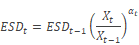
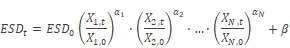
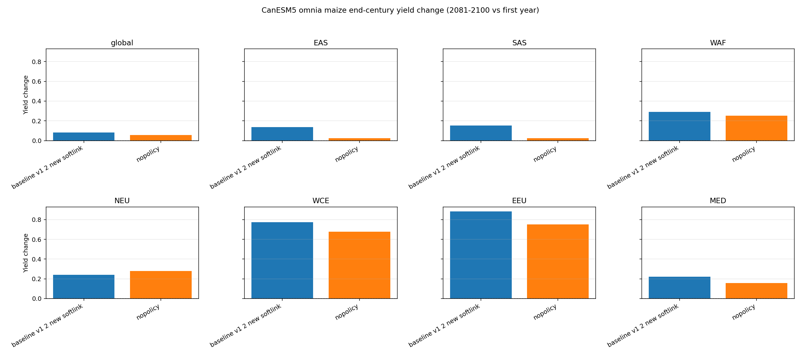
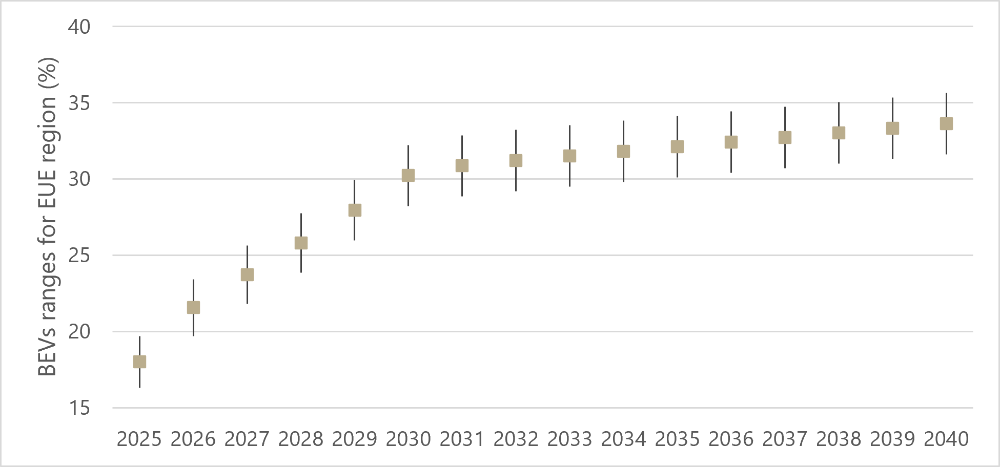
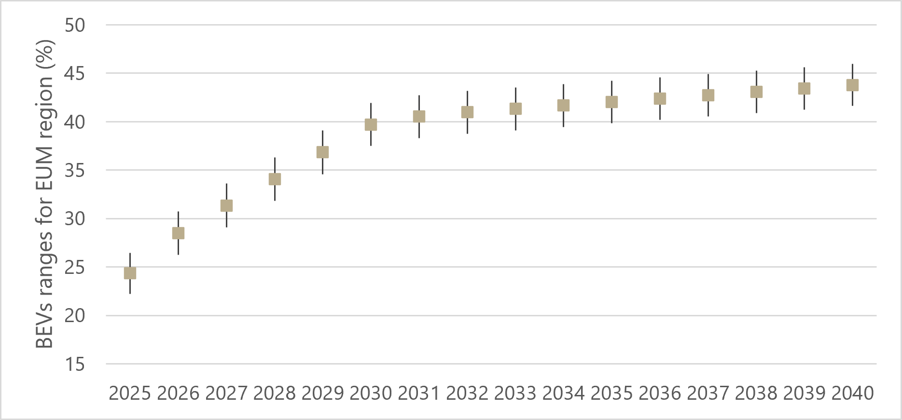

# Soft-links with Other Models

##  Demand projections approach

A standardised approach in demand projections for use in energy system models is to exogenously impose demand drivers obtained from other models (e.g., GEM-E3 (JRC, 2025), MSA (Kypreos & Lehtila, 2014)) or from reputable sources (O’Neill et al., 2017). Typical drivers include projections for population, GDP, GDP per capita, number of households, and sectoral outputs (Loulou, Goldstein, Kanudia, Lettila, & Remme, 2016).

The reference demand scenario is built by choosing elasticities of demand to their respective driver, for each region of the model. For example, in TIAM-UCL (S. Pye et al., 2020), each energy service demand (ESD) is projected from 2005 to 2100 based on the general expression:



Where α is the elasticity linking driver X to the ESD, which allows to adjust the strength of the relationship between the two. For alternative scenarios, the response of demands to changing conditions can be adjusted through elasticities.

In OMNIA, we aim to reduce the reliance on single variable elasticity, often based on historical data or modellers' assumptions, by further unpacking demand drivers and introducing sectoral-specific ones. The general expression adopted is the following:



The total number of drivers N depends on the specific driver considered. The parameters α and β still allow some freedom to decouple the demand projection from the driver. However, by using multiple drivers, we aim to reduce the reliance on expert evaluation and introduce a direct linkage to the relevant drivers.

Drivers can be grouped in two categories:

1. > *Primary drivers* represent the impacts of socio-economic development on end-use demand and include population, GDP, and GDP per capita. Primary drivers are defined per country and aggregated at regional level, and represent the basis for building demand projections, for example based on SSP scenarios.

2. > *Intermediate levers* are used to provide additional flexibility and adjust the demand to reflect the impacts of sector-specific, service-oriented drivers (e.g., heating or cooling degree days, floor space per capita) while maintaining consistency with primary drivers. Future projections of intermediate levers vary depending on factors such as geographic location, economic development, population density. Intermediate levers can be estimated based on historical development trends or obtained from other sectoral-specific studies

Finally, for specific subsectors energy service demands can be obtained through a detailed modelling approach to improve the projection accuracy.

**Primary drivers**

Drivers considered are population, GDP and GDP per capita. Here the data sources used are summarized. Growth rates are computed for the relevant OMNIA regions and set of years. As the IIASA dataset SSP Basic drivers v3.1 does not have data for Venezuela’s GDP, data is obtained from the GCAM model projections.

**Data sources for primary drivers**

| **Dataset** | **Description** |
|:------------|:----------------|
| **SSP Basic Drivers v3.1**<br>(IIASA, n.d.-a; IIASA, n.d.-b) | Historical data (1950/1980–2020) and SSP projections (2025–2100) for:<br>- Population<br>- GDP (PPP)<br>- Urbanization rate |
| **IMF World Economic Outlook (October 2024)** | Historical GDP data and short-term GDP growth projections (1980–2029). |
| **GCAM** | GDP projections for Venezuela. |

**Intermediate drivers**

Intermediate drivers are defined per each sector and are based on various sources. A summary of the drivers considered in the first version of the model, with some additional detail, is provided below. Both the residential and commercial sectors use heating degree days (HDD) and cooling degree days (CDD) to project heating and cooling demand. CDD are also used to estimate project AC penetration rates, also included as an additional driver. Similarly, the penetration rate of electrical appliances is considered in the residential sector, as well as floor area per capita. Specific demand projections are considered for the steel and aluminium sectors, based on global scenarios defined in the literature, as in the case of the aviation sector, where data from the NAVIGATE project has been adapted to OMNIA’s regions. Finally, we use IEA data to project the share between public and private road transport shares.

**Intermediate drivers, brief description, and sectoral coverage**

| **Driver** | **Description** | **Sector(s)** |
|:-----------|:----------------|:--------------|
| **Floor area per capita** | Three scenarios for floor area per capita based on different levels of building renovation (Zhang et al., 2024). | Residential |
| **Heating and cooling degree days (HDD/CDD)** | Derived from CICERO's METEOR model (Sanderson et al., 2025). | Residential,<br>Commercial |
| **Air conditioning (AC) penetration** | Estimated using a logit function based on income, with different parameterizations according to the average CDD of each region (Colelli et al., 2023; IEA, 2018c). | Residential,<br>Commercial |
| **Electrical appliance penetration** | Diffusion of the main residential electrical appliances based on the methodology proposed by McNeil & Letschert (2010). | Residential |
| **Steel demand** | Based on the demand scenarios developed by Steve Pye et al. (2022). | Industry |
| **Aluminium demand** | Based on global demand scenarios from the International Aluminium Institute (2021). | Industry |
| **Aviation demand** | Domestic and international aviation demand projections based on the NAVIGATE project (Dray et al., 2019). | Transport |
| **Road transport modal share** | Private and public road transport mode shares based on IEA MoMo data (IEA, 2018a). | Transport |

##  Water module

A simple water module is included in OMNIA through a soft link with MAgPIE, providing water consumed in the agriculture and livestock sector. Water consumed in the agriculture and livestock sector depends on the food demand which is calculated using socio-economic indicators and share of the population with different per capita kcal requirements based on body mass index. Similarly municipal water demand is calculated based on the level of urbanization and population. These are two exogenous demand trajectories that are inputted in the OMINA module. The water module includes primary supply of water from different sources: fresh water, saline water and ground water. Fresh surface water is obtained from rivers, lakes, and other natural bodies of water, while groundwater is sourced from underground aquifers. In areas facing a scarcity of freshwater or groundwater resources, seawater can be converted into fresh water through desalination processes. This method is crucial for ensuring a steady supply of potable water, particularly in arid regions or those with limited access to freshwater sources.

In the model, two desalination technologies are represented: reverse osmosis (RO) and thermal distillation. Both technologies convert seawater into freshwater suitable for municipal and industrial use, although they differ in their energy requirements and capital cost. Water from these conventional sources like fresh surface water and ground water after pumping undergoes appropriate treatment processes to meet water quality standards before being distributed through the water supply network to end-use sectors applications such as households, commercial establishments, and industries, this treatment requires certain amount of energy which is considered in the model. Freshwater undergoes a comprehensive treatment process before it is distributed for various uses, including residential, commercial, and industrial applications. The energy requirements for municipal water treatment vary based on several factors, including the source of the water—whether it's drawn from rivers, lakes, or underground aquifers—the specific methods employed for purification, and the unique local environmental conditions. A portion of the municipal water supplied is consumed through evaporation, outdoor irrigation, incorporation into products, leakage, and other non-returned uses. The remaining water is discharged as wastewater. Depending on the country's wastewater collection and treatment infrastructure, a fraction of this wastewater is collected and treated and remaining uncollected wastewater is discharged to the environment as untreated water. Treated wastewater is reused for the end-use purposes. Energy used for water extraction, treatment and distribution is linked with the energy inputs in the energy module of the OMNIA model. The energy use factors are generally obtained from the latest peer-reviewed publications.


```{figure} ../images/image54.png
:name: fig-wtr-res
:alt: Water module design
:width: 90%

Water module design.
```

We consider four distinct categories of water demand in this water module:

1. Irrigation and Livestock Water Demand: This category encompasses the water required for agricultural irrigation and livestock. In this module only water consumption in the livestock is accounted and not the energy required for water pumping as that is accounted in the agricultural energy demand module

<!-- end list -->

I.  Municipal Water Demand: This involves water consumption for residential, commercial, and industrial use within urban areas.

II.  Water Demand for Primary Energy Extraction: This includes the water needed for processes related to the extraction of energy resources, such as oil and gas.

III.  Water Demand for Cooling in the Power Sector: This pertains to the water used for cooling in thermal power plants, which is essential for maintaining operational efficiency.

Water used in the industrial sector (outside energy extraction) is not included in this version. Integration may be considered in future versions of the model if it is deemed necessary for addressing research questions in this project. Water trade is also not represented in this module. The water resource available in each region is taken from MAgPIE to maintain the consistency between the two models, while municipal water demand is calculated based on socioeconomic indicators such as GDP, urbanisation and population using the equation used in (Hejazi, Edmonds, Chaturvedi, Davies, & Eom, 2013). Demand in the power sector is intricately linked to the amount of power generated and the efficiency of the cooling equipment utilised. Consequently, an increase in power output typically results in a corresponding increase in cooling water demand. Similarly, the mining sector’s water requirements are directly related to its production levels, highlighting the interdependence between water and resource extraction processes.

## Industrial sector circular economy

Most IAMs lack detailed representations of material flows across supply chains and product lifecycles. This limits their ability to capture the effects that circular economy strategies (e.g., reuse and recycling of materials) may have on commodity demands and decarbonisation strategies. To address this, we establish a linkage between OMNIA and ENGAGE. OMNIA provides a detailed representation of industrial technologies and their energy consumption, while ENGAGE represents economy-wide trade and material flows from resource extraction to recycling. Linking the two models enables a more complete assessment of how circular economy policies could affect emissions, energy demand, and economic activities across sectors and regions. Here we summarise the core process.

The linkage is bidirectional and iterative. OMNIA passes the energy system configuration and mitigation pathways to ENGAGE, which in turn adjusts upstream and downstream markets to reach economic equilibrium. These changes, for example in material demand and GDP (calculated endogenously in ENGAGE), are fed back into OMNIA to refine the energy service demand and regional production. {numref}`fig-eng-res` summarises the conceptual flow of information between the two models. The process is iterated until convergence. The stopping criteria will be case specific and will require an *ad hoc* tuning process. In any case, due to time constraints, the linkage will be constrained to either 5 iterations or to a threshold value of less than 5% change in the energy system and demand generator after n iterations.

At the core of the linkage are shared assumptions that are exogenously imposed on both models, i.e. socioeconomic pathways, technology costs and efficiencies, climate policies (i.e., carbon pricing), and material demand and stock dynamics, ensuring consistency across models on key scenarios assumptions.

The linkage enables OMNIA to assess the implications of different decarbonisation pathways and net-zero targets in an integrated framework alongside circular economy policies, helping to identify synergies, trade-offs, and rebound effects from an economy-wide perspective. At the same time, it allows ENGAGE to incorporate detailed energy system dynamics into macroeconomic analysis, supporting a more comprehensive evaluation of how decarbonisation and circular economy strategies affect economic performance, sectoral transitions, trade, and regional welfare. This modelling framework supports the assessment of policies such as recycled content mandates, incentives for scrap-based production, material efficiency improvements, and trade restrictions to promote local reuse. It can also be applied to analyse alternative climate scenarios, including those consistent with 2°C or 1.5°C targets, as well as pathways involving temperature overshoot.


```{figure} ../images/image55.png
:name: fig-eng-res
:alt: Diagram of the conceptual linkage and information flow between ENGAGE and OMNIA
:width: 90%

Diagram of the conceptual linkage and information flow between ENGAGE and OMNIA.
```

##  Interaction between energy system and land-use

The link between OMNIA and MAgPIE focuses on three critical interactions, see {numref}`fig-mag-res`:  

1.  Bioenergy demand and supply  

2.  Land Use and Land Use Change GHG emissions

3.  GHG prices.  

OMNIA provides MAgPIE with the level of biomass and bioenergy demand and CO<sub>2</sub> prices under different scenarios of socio-economic and global temperature evolution, while MAgPIE provides biomass ressource availability, costs and related GHG emissions when producing the requested amount of bioenergy under the same socio-economic and global temperature scenarios.   In the climate mitigation scenarios, GHG prices from OMNIA model are taken as an input in MAgPIE and then emissions trajectories from MAgPIE are inputted back to OMNIA model.


```{figure} ../images/image56.png
:name: fig-mag-res
:alt: Soft-linking between OMNIA and MAgPIE
:width: 90%


Soft-linking between OMNIA and MAgPIE.

Biomass primary energy is composed of energy crops (crops purposely cultivated for energy), food crops (which provide 1<sup>st</sup> generation biofuels, e.g., ethanol), and solid biomass (encompassing agricultural and forest residues). Biomass feedstock is then converted to different forms of energy, which are then utilised in diverse end-use sectors. MAgPIE provides OMNIA with the availability of the different types of biomass, along with the associated prices, hence enhancing the level of detail for each type of biomass represented in the model. The data collected from MAgPIE on the variables of interest includes amount (EJ/yr), cost (US$2017/EJ), and emissions (Mt CO<sub>2</sub>/yr). Note that the emissions are to be exported per sector overall, i.e., land-use or agriculture, rather than per individual crop.


```{figure} ../images/image57.png
:name: fig-mag-det
:alt: Detailed representation of the MAgPIE to OMNIA mapping
:width: 90%

Detailed representation of the MAgPIE to OMNIA mapping.
```

To enable the integration of non-energy emissions from MAgPIE, a dedicated framework has been implemented in OMNIA. Six new emission commodities, representing agricultural non-energy and Land Use, Land-Use Change and Forestry (LULUCF) CO₂, CH₄ and N₂O emissions, have been introduced together with six generic processes that act as placeholders for externally generated emission trajectories. The activity of these processes is controlled through scenario-specific bounds, allowing MAgPIE-derived emission trajectories to be incorporated without modifying the core model structure. In addition, a dedicated scenario table has been prepared to facilitate future updates of the overall emissions trajectory through the user-defined constraints. These dedicated emission commodities can then be selectively included when applying emissions constraints in OMNIA.

Agriculture non-energy CH₄ emissions imported from MAgPIE include emissions from rice cultivation, animal waste management systems, enteric fermentation of livestock, managed peatlands, and biomass burning. Agriculture non-energy N₂O emissions include emissions from animal waste management systems, inorganic fertilizer application on cropland and pasture, manure application to cropland, crop residue decay, soil organic matter loss, pasture soils, managed peatlands, and biomass burning. CO₂ emissions from the land-use change sector are also imported from MAgPIE and incorporated into the OMNIA emissions trajectory. Historical CO₂ emissions from the land-use sector are consistent with the range of estimates reported in the Global Carbon Budget inventory.

##  Physical climate impacts

OMNIA model is soft-linked with CICERO-SCM to estimate changes in global surface air temperature under different scenarios, enabling the assessment of the climate implications of alternative transition pathways. Emission trajectories for different emission species generated by OMINA are used as inputs to CICERO-SCM, while emissions of species not represented in OMNIA are infilled using the corresponding baseline scenario narrative. {numref}`fig-temp-cng` and {numref}`fig-temp-prec` shows temperature and precipitation change in the no policy and NDC\_LTT scenarios when OMINA and CICERO-SCM are soft-linked.


```{figure} ../images/image58.png
:name: fig-temp-cng
:alt: Changes in global surface air temperature
:width: 90%

Changes in global surface air temperature.


```{figure} ../images/image59.png
:name: fig-temp-prec
:alt: METEOR annual mean temperature (tas) and precipitation (pr) scaled CanESM5 projections to the omnia** baseline **scenario.** 
:width: 90%

METEOR annual mean temperature (tas) and precipitation (pr) scaled CanESM5 projections to the omnia** baseline **scenario** .

OMNIA is also soft-linked with a climate impact model, METEOR, developed under the DIAMOND EU-project by CICERO. OMNIA can deliver the GHG emissions (CO<sub>2</sub>, CH<sub>4</sub> and, NO<sub>2</sub>) to the SILICONE model (internal to CICERO) used to estimate the remaining emission gases. Once all emissions’ trajectories for a given scenario are estimated, they will be input into the METEOR climate model to estimate spatially resolved physical variables like temperature and precipitation, and these physical variables can be included in the damage function. The soft-link allows assessing changes in heating and cooling demand, land crop yields, and other climate change-related impacts.

Regional variations in heating and cooling degree days projected by METEOR can be used to estimate changes in heating and cooling end-use service demand relative to a case in which regional climate impacts are not considered. Emissions changes due to this updated heating and cooling demand are again inputted to METEOR or CICERO-SCM to estimate its impacts on the temperature change. {numref}`fig-emi-flow` shows the flow of data from OMNIA to METEOR and then back to OMNIA model. Here is one illustration of this model linkages.


```{figure} ../images/image60.png
:name: fig-emi-flow
:alt: Illustration demonstrates the flow of emissions data from OMNIA to METEOR 
:width: 90%

Illustration demonstrates the flow of emissions data from OMNIA to METEOR .

{numref}`fig-hdd-cdd` presents the initial results based on the linkage between the OMNIA and METEOR models for two scenarios: the baseline scenario (NDC\_LTT), which incorporates countries' Nationally Determined Contributions (NDCs) and long-term climate targets, and the no-policy scenario, which represents the cost-optimal emissions trajectory without any climate policy interventions at different resolutions, showcasing the flexibility in terms of the regional resolution. At the global level, the climate change impact on heating and cooling services and additional investment requirements to adapt to these changes might not be significant but at the regional level including such dynamics helps to get better estimates of electricity sector dynamics.


```{figure} ../images/image61.png
:name: fig-hdd-cdd
:alt: Heating degree days (HDD) and cooling degree days (CDD) at global, regional and city level
:width: 90%

Heating degree days (HDD) and cooling degree days (CDD) at global, regional and city level.

METEOR is linked with a global crop yield emulator in its impact module, covering the five staple crops—maize, rice, soybean, spring wheat, and winter wheat—which together account for most of the global caloric production. This linkage enables the estimation of the impacts of climate change on crop yields. Variations in crop yields based on these emissions can be input in MAgPie which will in turn influences the landuse change emissions and impact the bioenergy supply availability as mentioned in the above section. {numref}`fig-yd-mai` shows the yield change in the baseline and no policy scenario based on OMINA scenario runs.




```{figure} ../images/image63.png
:name: fig-yd-mai
:alt: Change in the yield of Maize and wheat crops estimates.
:width: 90%

Change in the yield of Maize and wheat crops estimates.
```

##  Behavioural aspects and preferences on BEVs adoption

Most IAMs lack of considering, a) the heterogeneity between and within actors, b) the rational behavioural assumptions for technology adoption. This means that in reality not every person is equally affected by financial signals (i.e., technology costs, operating costs), that people adopt technologies for a variety of reasons that are not necessarily financial, and as a result different people adopt new technologies at different times.

To address these aspects, we establish a soft link between OMNIA and the behavioural change model developed by UNIBAS, the model is based on psychological basis (Günther et al., 2025; Kaiser, 2021). The university developed a specific module on human behaviour under to be linked to several IAMs, analysing the adoption of Battery Electric Vehicles (BEVs) in European regions.

The behavioural change model implicitly includes the heterogeneity between actors and the rational behavioural assumptions for technology adoption, and it is based on empirical data on EV adoption decision-making (i.e., an experiment where people indicate their willingness to adopt cars based on various car and context attributes). This allows the model to make more realistic EV adoption estimates free of individual, rational cost-optimization and rooted in heterogeneous behavioural reactions. Linking this model to OMNIA enables a more complete assessment on the BEVs adoption in the model.

The soft link is one-directional: UNIBAS provided OMNIA with BEV adoption ranges for selected European countries for six scenarios, reflecting different grades on BEVs tariff and inclusion or exclusion of uncertainty in energy costs. For this soft link the outputs from the base scenario “*no tariffs on electric vehicles and no uncertainty in fuel prices”* are used. The scenario is used to test the feasibility of the soft link. The adoption ranges are first regionalised to align with the OMNIA EU regions, EUE, EUM, EUW. The dataset includes four countries per OMNIA region, and the lower and upper bounds of BEV adoption are aggregated using population-weighted averages Subsequently, the regionalised data are applied as constraints within the model for the OMNIA EU regions. Specifically, the constraints are implemented in the transport sector by imposing lower and upper bounds on the annual deployment of new electric vehicles in each EU region.

**Allocation of countries to OMNIA EU regions**

| **OMNIA region** | **Countries** |
|:-----------------|:--------------|
| **`EUE`** | Bulgaria,<br>Czechia,<br>Lithuania,<br>Poland |
| **`EUW`** | Denmark,<br>Germany,<br>Netherlands |
| **`EUM`** | France,<br>Italy,<br>Greece,<br>Portugal |





```{figure} ../images/image72.png
:name: fig-bev-sl
:alt: BEVs technology adoption ranges used in OMNIA value regionalised for EU regions in the model
:width: 90%

BEVs technology adoption ranges used in OMNIA value regionalised for EU regions in the model.
```


This soft-link enables OMNIA to assess the implications of different decarbonisation pathways and net-zero targets within an integrated framework, together with the effects of heterogeneous behavioural reactions on technology adoption, specifically BEVs adoption. The soft-link helps to identify synergies, trade-offs, and rebound effects from an economy-wide perspective and support the assessment of policies by capturing heterogeneous customer responses to policy signals, societal aspects and energy prices, thereby affecting the timing and extent of BEV uptake.

##  Electricity trade in Europe

Integrated Assessment Models (IAMs) typically represent electricity trade between regions using simplified assumptions that do not explicitly account for transmission network constraints. As a result, electricity exchanges may be overestimated, leading to an unrealistic representation of regional electricity markets and the spatial deployment of generation technologies.

To address this aspect, a soft link has been established between OMNIA and the openTEPES model, developed by the Universidad Pontificia Comillas. openTEPES is a transmission expansion planning model that represents electricity system operation with high temporal and spatial resolution while explicitly accounting for transmission network constraints. This detailed representation enables realistic electricity exchange patterns between interconnected countries to be simulated.

The soft link uses the electricity exchange results from openTEPES to derive transmission-constrained interregional electricity trade limits for OMNIA. Incorporating these limits into the IAM enables regional electricity exchanges to better reflect transmission network constraints, improving the representation of the electricity system in long-term energy system scenarios.

The implementation is based on openTEPES results for the year 2030, obtained using the ENTSO-E National Trends 2030 (NT2030) network configuration. Country-to-country electricity exchange profiles were first aggregated to match the regional representation adopted in OMNIA. The hourly exchange values were then converted into annual electricity trade limits by accounting for the duration of each time step and implemented as upper bounds on interregional electricity exchanges.

As openTEPES results were available only for the year 2030, trade limits for intermediate years were obtained through linear interpolation between the base-year values and the 2030 limits. For years beyond 2030, the trade limits were extrapolated by extending the trend defined by the base year and the 2030 values.


```{figure} ../images/image64.png
:name: fig-trd-elc
:alt: Electricity trade upper bound in 2030
:width: 90%

Electricity trade upper bound in 2030.
